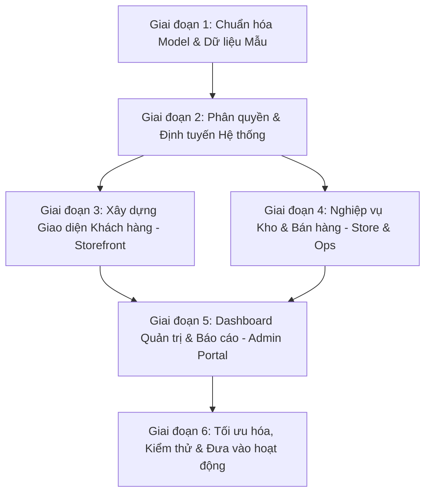

# KẾ HOẠCH & CÁC BƯỚC TRIỂN KHAI HOÀN THIỆN WEBSITE FRESH FOOD

> **Dự án:** Fresh Food - Hệ thống Website Bán lẻ & Quản lý Chuỗi Cửa Hàng Thực Phẩm Tươi Sống  
> **Công nghệ:** Laravel 12 + Inertia.js v2 + Vue 3 (Composition API, TypeScript) + Tailwind CSS + MySQL  
> **Đặc thù kinh doanh:** Quản lý hạn sử dụng, xuất kho theo nguyên tắc **FEFO (First Expired, First Out)**, quản lý giá theo từng chi nhánh, đổi trả thực phẩm hỏng, tích điểm thành viên.

---

## 📊 I. ĐÁNH GIÁ HIỆN TRẠNG DỰ ÁN

| Thành phần | Trạng thái hiện tại | Đánh giá & Việc cần làm ngay |
| :--- | :--- | :--- |
| **Cơ sở dữ liệu (Database)** | Đã hoàn thành 34 Migration files (`cua_hang`, `san_pham`, `lo_hang`, `ton_kho`, `phieu_nhap`, `don_hang`, `phieu_doi_tra`,...) | ✅ Đã đầy đủ cấu trúc bảng, khóa ngoại, chỉ mục. Cần kiểm tra chạy lại `php artisan migrate`. |
| **Tầng Model (Eloquent)** | Mới chỉ có model mặc định `User.php` | ⚠️ **Thiếu toàn bộ ~25 Models** liên quan đến nghiệp vụ và các phương thức quan hệ (`hasMany`, `belongsTo`, `belongsToMany`, scopes). |
| **Dữ liệu mẫu (Seeders)** | Chỉ có `DatabaseSeeder.php` tạo 1 tài khoản test | ⚠️ **Thiếu dữ liệu mẫu thực tế** để test UI/UX (Cửa hàng, Danh mục rau/thịt/cá/trái cây, Nhà cung cấp, Sản phẩm, Lô hàng có HSD, Mã giảm giá). |
| **Backend Logic (Controllers/Services)** | Mới có Auth & Settings mặc định của Laravel starter kit | ⚠️ **Chưa có Controllers & Business Logic** cho: Giỏ hàng, Đặt hàng, Quản lý kho, Xuất FEFO, Khuyến mãi, Đổi trả. |
| **Giao diện Khách hàng (Storefront)** | Mới chỉ có trang Welcome mặc định của Laravel | ⚠️ **Cần xây dựng toàn bộ:** Trang chủ, Trang danh mục, Chi tiết sản phẩm, Giỏ hàng, Checkout, Tra cứu đơn hàng. |
| **Giao diện Quản trị (Admin / POS / Kho)** | Chỉ có Dashboard cơ bản | ⚠️ **Cần xây dựng phân hệ:** Quản lý kho lô hàng, Phiếu nhập/xuất/kiểm kê, Bán hàng tại quầy/duyệt đơn online, Báo cáo doanh thu & cận date. |

---

## 🗺️ II. LỘ TRÌNH TRIỂN KHAI CHI TIẾT (6 GIAI ĐOẠN)

---

### GIAI ĐOẠN 1: TẠO ELOQUENT MODELS & DỮ LIỆU MẪU (SEEDERS)
*Mục tiêu: Đảm bảo tầng dữ liệu hoạt động trơn tru với đầy đủ quan hệ Eloquent và có sẵn dữ liệu trực quan để phát triển giao diện.*

- [x] **Bước 1.1: Tạo toàn bộ Eloquent Models & Thiết lập Relationships**
  - **Nhóm Cửa hàng & Nhà cung cấp:**
    - `CuaHang.php`: quan hệ với `User`, `TonKho`, `GiaSanPhamCuaHang`, `DonHang`, `PhieuNhap`.
    - `NhaCungCap.php`: quan hệ với `PhieuNhap`.
  - **Nhóm Danh mục & Sản phẩm:**
    - `DanhMuc.php`: quan hệ đệ quy cha-con (`danhMucCha`, `danhMucCon`), quan hệ `sanPhams`.
    - `SanPham.php`: quan hệ `danhMuc`, `hinhAnhs`, `loHangs`, `giaTheoCuaHang`, `danhGias`.
    - `HinhAnhSanPham.php`, `GiaSanPhamCuaHang.php`.
  - **Nhóm Kho & Lô hàng (FEFO Core):**
    - `LoHang.php`: quan hệ `sanPham`, `chiTietPhieuNhap`, `tonKhos`. Scope `scopeConHan()`, `scopeSapHetHan()`.
    - `TonKho.php`: quan hệ `cuaHang`, `loHang`.
    - `PhieuNhap.php` & `ChiTietPhieuNhap.php`.
    - `PhieuXuat.php`, `ChiTietPhieuXuat.php`, `ChiTietXuatKho.php`.
    - `PhieuKiemKe.php`, `ChiTietKiemKe.php`, `TheKho.php`.
  - **Nhóm Đơn hàng & Khách hàng:**
    - `DiaChiGiaoHang.php`: quan hệ `user`.
    - `GioHang.php`: quan hệ `user`, `sanPham`, `cuaHang`.
    - `DonHang.php` & `ChiTietDonHang.php`: quan hệ `user`, `cuaHang`, `maGiamGia`, `chiTiets`.
    - `MaGiamGia.php`: scope `scopeHieuLuc()`, hàm kiểm tra điều kiện áp dụng.
    - `DanhGiaSanPham.php`, `ThongBao.php`.
  - **Nhóm Đổi trả & Điểm thưởng:**
    - `PhieuDoiTra.php` & `ChiTietDoiTra.php`: liên kết đơn hàng, khách hàng, nhân viên duyệt.
    - `LichSuTichDiem.php`: liên kết `user`, ghi log cộng/trừ điểm.
  - **Cập nhật `User.php`:**
    - Bổ sung `role` (`khach_hang`, `nhan_vien`, `quan_ly`, `admin`), `store_id`, `loyalty_points`, các quan hệ `diaChis`, `donHangs`, `cuaHang`.

- [ ] **Bước 1.2: Tạo Seeder dữ liệu thực tế chất lượng cao**
  - Tạo `CuaHangSeeder.php`: 3-5 chi nhánh tại TP.HCM/Hà Nội (có tọa độ GPS, địa chỉ, giờ mở cửa).
  - Tạo `DanhMucSeeder.php`: Rau củ hữu cơ, Trái cây tươi, Thịt heo - bò - gà sạch, Thủy hải sản tươi sống, Trứng - Sữa bơ, Gia vị thực phẩm.
  - Tạo `NhaCungCapSeeder.php`: Nông trại Đà Lạt, Nông sản Miền Tây, Hải sản Phan Thiết,...
  - Tạo `SanPhamSeeder.php`: 30-50 sản phẩm với đầy đủ ảnh minh họa, quy cách (Kg, Gói, Hộp), xuất xứ, nhiệt độ bảo quản.
  - Tạo `LoHangSeeder.php`: Các lô hàng có ngày sản xuất, ngày hết hạn khác nhau (để test FEFO và cảnh báo cận date).
  - Tạo `MaGiamGiaSeeder.php`: Mã giảm % (FRESH10), mã tiền mặt (GIAM50K), mã cho đơn tối thiểu.
  - Tạo `UserSeeder.php`: 1 Admin, 2 Quản lý cửa hàng, 3 Nhân viên thu ngân/kho, 5 Khách hàng mẫu.

- [ ] **Bước 1.3: Chạy nghiệm thu cơ sở dữ liệu**
  - Thực thi: `php artisan migrate:fresh --seed`
  - Đảm bảo không có lỗi Foreign Key hoặc sai lệch kiểu dữ liệu.

---

### GIAI ĐOẠN 2: PHÂN QUYỀN & KIẾN TRÚC ROUTING
*Mục tiêu: Đảm bảo khách hàng, nhân viên và ban quản trị truy cập đúng chức năng theo vai trò.*

- [ ] **Bước 2.1: Middleware kiểm tra Vai trò (Role-based Access Control)**
  - Tạo middleware `CheckRole.php` (hoặc kiểm tra role trực tiếp trên route group):
    - Khách hàng (`khach_hang`): Truy cập trang mua sắm, giỏ hàng, thông tin cá nhân, lịch sử mua hàng.
    - Nhân viên (`nhan_vien`): Truy cập POS bán hàng tại quầy chi nhánh, đóng gói đơn, quản lý kiểm kê kho chi nhánh của mình.
    - Quản lý (`quan_ly`): Quản lý nhập/xuất kho chi nhánh, duyệt đơn hủy/đổi trả, xem báo cáo doanh thu chi nhánh.
    - Admin (`admin`): Toàn quyền cấu hình chuỗi cửa hàng, quản trị danh mục, nhân sự, bảng giá, báo cáo toàn hệ thống.

- [ ] **Bước 2.2: Phân chia cấu trúc Route rõ ràng (`routes/web.php`)**
  - `routes/client.php` hoặc nhóm route Client: `/`, `/san-pham`, `/san-pham/{slug}`, `/danh-muc/{slug}`, `/gio-hang`, `/thanh-toan`, `/tra-cuu-don-hang`.
  - `routes/admin.php`: Nhóm tiền tố `/admin` kèm middleware `['auth', 'role:admin,quan_ly']`.
  - `routes/store.php` (POS & Kho): Tiền tố `/store` hoặc tích hợp trong admin panel dành cho nhân viên chi nhánh.

---

### GIAI ĐOẠN 3: XÂY DỰNG GIAO DIỆN & TRẢI NGHIỆM KHÁCH HÀNG (STOREFRONT)
*Mục tiêu: Giao diện chuẩn phong cách thực phẩm tươi sạch - hiện đại, tốc độ tải nhanh, màu sắc tươi sáng, tối ưu chuyển đổi đặt hàng.*

- [ ] **Bước 3.1: Xây dựng Layout & Thành phần dùng chung (Storefront Layout)**
  - `StoreHeader.vue`:
    - Thanh thông báo trên cùng (Flash message, hotline giao hàng nhanh 2h).
    - Bộ chọn chi nhánh / Cửa hàng gần nhất (dựa trên địa chỉ người dùng).
    - Ô tìm kiếm thông minh (Live search sản phẩm).
    - Nút Giỏ hàng nổi bật (có badge số lượng, dropdown xem nhanh giỏ hàng).
    - Nút Đăng nhập/Đăng ký/Tài khoản cá nhân.
  - `StoreFooter.vue`: Thông tin giấy chứng nhận ATTP, chính sách đổi trả trong 24h, danh sách chi nhánh, liên kết MXH.
  - `ProductCard.vue`: Card sản phẩm tươi sống gồm ảnh, nhãn giảm giá, tag "Tươi mới hôm nay", giá gốc/giá bán, đơn vị tính (Kg/Khay), nút bấm thêm vào giỏ nhanh.

- [ ] **Bước 3.2: Trang chủ Cửa hàng (`resources/js/pages/client/Home.vue`)**
  - Banner Slider nổi bật các chương trình ưu đãi, combo dinh dưỡng.
  - Thanh Danh mục icon trực quan (Rau củ, Thịt heo, Cá hồi, Trái cây nhập khẩu,...).
  - Khu vực **"Flash Sale / Giá sốc hôm nay"** có đồng hồ đếm ngược.
  - Khu vực **"Sản phẩm tươi mới về sáng nay"** (lọc theo lô hàng mới nhất).
  - Khối Cam kết chất lượng (100% VietGAP/Organic, Giao hàng siêu tốc 2h, Đổi trả miễn phí nếu dập nát).

- [ ] **Bước 3.3: Trang Danh mục & Danh sách Sản phẩm (`Category.vue` / `Products.vue`)**
  - Bộ lọc thông minh đa tiêu chí: Lọc theo mức giá, danh mục con, xuất xứ, sắp xếp (bán chạy, giá tăng/giảm, hàng mới về).
  - Phân trang hoặc Infinite Scroll với Inertia v2.
  - Xem theo dạng Grid hoặc List.

- [ ] **Bước 3.4: Trang Chi tiết Sản phẩm (`ProductDetail.vue`)**
  - Thư viện ảnh sản phẩm (chọn ảnh phóng to, ảnh thực tế đóng gói).
  - Thông tin nguồn gốc xuất xứ, tiêu chuẩn nuôi trồng/thu hoạch, hạn sử dụng khuyến nghị.
  - Chọn số lượng / khối lượng (Ví dụ: 0.5kg, 1kg hoặc số lượng khay).
  - Hiển thị tình trạng còn hàng theo chi nhánh cửa hàng đang chọn.
  - Mục Đánh giá & Bình luận của khách hàng kèm hình ảnh thực tế.
  - Danh sách gợi ý: "Thường mua kèm" (Mẹo nấu ăn, nguyên liệu đi kèm).

- [ ] **Bước 3.5: Giỏ hàng & Luồng Đặt hàng (Checkout Flow)**
  - `Cart.vue`: Quản lý giỏ hàng, cập nhật số lượng với tính toán giá tức thì, nhập mã giảm giá xem trước số tiền giảm.
  - `Checkout.vue`:
    - Chọn hình thức nhận hàng: **Giao hàng tận nơi** hoặc **Nhận tại cửa hàng**.
    - Chọn chi nhánh xuất kho gần nhất.
    - Nhập địa chỉ giao hàng (tích hợp chọn từ sổ địa chỉ đã lưu).
    - Chọn khung giờ giao hàng (Đặc thù thực phẩm tươi sống: 8h-10h, 14h-16h,...).
    - Áp dụng Voucher & Chọn dùng điểm tích lũy (`loyalty_points`).
    - Phương thức thanh toán: COD (Tiền mặt khi nhận hàng), Quét mã VietQR Chuyển khoản, Ví điện tử (VNPay/MoMo).
  - `OrderSuccess.vue`: Thông báo đặt hàng thành công, hiển thị mã đơn hàng và mã QR theo dõi tiến độ.

- [ ] **Bước 3.6: Trang Quản lý Khách hàng (Customer Account Portal)**
  - Quản lý sổ địa chỉ nhận hàng (`dia_chi_giao_hang`).
  - Lịch sử đơn hàng & Trạng thái đơn (Chờ xác nhận -> Đang đóng gói -> Đang giao -> Đã hoàn thành).
  - **Chức năng Yêu cầu Đổi trả Hàng:** Cho phép khách bấm đổi/trả với sản phẩm bị dập, hư hại trong 24h kèm ảnh chụp.
  - Quản lý Điểm thưởng & Lịch sử tích/tiêu điểm (`lich_su_tich_diem`).

---

### GIAI ĐOẠN 4: NGHIỆP VỤ KHO & BÁN HÀNG ĐẶC THÙ THỰC PHẨM TƯƠI SỐNG (OPERATIONS)
*Mục tiêu: Đảm bảo kiểm soát chặt chẽ hạn sử dụng, xuất kho đúng nguyên tắc FEFO, kiểm kê và đổi trả hàng minh bạch.*

- [ ] **Bước 4.1: Xây dựng Service Xuất Kho FEFO (`InventoryService.php`)**
  - Khi đơn hàng được duyệt/đóng gói:
    - Tìm kiếm tồn kho của sản phẩm tại cửa hàng được giao.
    - Sắp xếp các lô hàng còn tồn theo `lo_hang.ngay_het_han ASC` (Lô hết hạn sớm nhất được ưu tiên xuất trước).
    - Tự động trừ số lượng ở `ton_kho` và ghi bản ghi vào `chi_tiet_xuat_kho` & `the_kho`.
    - Trả về cảnh báo nếu số lượng hàng có hạn sử dụng an toàn không đủ đáp ứng.

- [ ] **Bước 4.2: Phân hệ Quản lý Nhập Kho (`app/Http/Controllers/PhieuNhapController.php`)**
  - Giao diện tạo phiếu nhập từ Nhà cung cấp: Chọn NCC, chọn cửa hàng nhận.
  - Nhập từng mặt hàng: Đơn giá nhập, Số lượng, Số lô sản xuất, Ngày sản xuất (NSX), Ngày hết hạn (HSD).
  - Sau khi hoàn thành phiếu nhập: Tự động tạo bản ghi `lo_hang`, cập nhật số lượng vào bảng `ton_kho` của chi nhánh đó, ghi thẻ kho.

- [ ] **Bước 4.3: Phân hệ Cảnh báo Cận Hạn Sử Dụng (Near-Expiry Alert) & Giảm giá xả hàng**
  - Dashboard danh sách các lô hàng:
    - 🔴 **Báo động Đỏ:** Lô hàng còn ≤ 1 ngày (Cần xuất hủy hoặc giảm giá sâu 50-70%).
    - 🟡 **Báo động Vàng:** Lô hàng còn ≤ 3 ngày.
    - 🟢 **An toàn:** Lô hàng mới nhập.
  - Nút chuyển nhanh lô cận date thành giá khuyến mãi xả hàng trong ngày.

- [ ] **Bước 4.4: Phân hệ Kiểm kê Kho & Cân bằng Tồn kho (`PhieuKiemKeController.php`)**
  - Tạo đợt kiểm kê theo định kỳ (cuối ngày hoặc hàng tuần).
  - So sánh Tồn lý thuyết vs Tồn thực tế -> Tính chênh lệch (Thất thoát do bốc hơi, hư hỏng dập nát).
  - Xác nhận cân bằng kho và lưu nguyên nhân hao hụt.

- [ ] **Bước 4.5: Phân hệ Xử lý Đổi Trả Hàng Hỏng (`PhieuDoiTraController.php`)**
  - Nhân viên/Quản lý duyệt yêu cầu đổi trả từ khách hàng hoặc tạo trực tiếp tại quầy:
    - Đánh giá tình trạng: Hư hỏng tiêu hủy, hoặc Trả về nhà cung cấp.
    - Hình thức: Đổi sản phẩm tương đương (xuất kho bù) hoặc Hoàn tiền lại cho khách hàng.
    - Tự động điều chỉnh thẻ kho và trừ/cộng lại điểm tích lũy tương ứng.

---

### GIAI ĐOẠN 5: TRANG QUẢN TRỊ TỔNG THỂ (ADMIN DASHBOARD & BÁO CÁO)
*Mục tiêu: Cung cấp bức tranh toàn cảnh về doanh số, tồn kho, lợi nhuận và quản trị toàn bộ hệ sinh thái Fresh Food.*

- [ ] **Bước 5.1: Dashboard Thống kê & Phân tích Trực quan**
  - Biểu đồ Doanh thu theo ngày, tuần, tháng, quý (hỗ trợ lọc theo từng chi nhánh cửa hàng).
  - Thống kê Đơn hàng: Tỷ lệ giao hàng thành công, đơn hủy, đơn đổi trả.
  - Thống kê Tỷ lệ hao hụt / Hủy hàng do hết date (chỉ số sống còn của cửa hàng thực phẩm).
  - Top 10 sản phẩm bán chạy nhất / Danh mục mang lại doanh thu cao nhất.

- [ ] **Bước 5.2: Quản lý Danh mục & Sản phẩm Nâng cao**
  - CRUD Danh mục sản phẩm (Hỗ trợ danh mục đa cấp, upload icon/ảnh).
  - CRUD Sản phẩm: Thông tin chi tiết, upload nhiều ảnh, cài đặt đơn vị tính, bảo quản.
  - Cấu hình Bảng giá theo từng chi nhánh (`gia_san_pham_cua_hang`): Cho phép chi nhánh trung tâm áp giá khác chi nhánh tỉnh/vùng ven.

- [ ] **Bước 5.3: Quản lý Khuyến Mãi & Voucher (`MaGiamGiaController.php`)**
  - Tạo mã giảm giá theo %, tiền mặt, giới hạn số lượng, giá trị đơn tối thiểu, mức giảm tối đa.
  - Quản lý thời hạn chạy chiến dịch khuyến mãi (Tự động kích hoạt/hết hạn).

- [ ] **Bước 5.4: Quản lý Chi nhánh Cửa hàng & Nhân sự**
  - Quản lý danh sách chi nhánh (`cua_hang`): Địa chỉ, hotline, tọa độ Google Maps, giờ đóng/mở cửa.
  - Quản lý Tài khoản & Phân quyền nhân viên: Gán nhân viên vào đúng `store_id` để giới hạn quyền dữ liệu của chi nhánh đó.

---

### GIAI ĐOẠN 6: TỐI ƯU HÓA, TEST & TRIỂN KHAI (POLISH & DEPLOY)
*Mục tiêu: Đảm bảo hiệu năng cao, trải nghiệm mượt mà, không phát sinh lỗi dữ liệu khi vận hành thực tế.*

- [ ] **Bước 6.1: Viết Kiểm thử Tự động (Pest Feature Tests)**
  - Test luồng FEFO: Kiểm tra khi tạo đơn hàng, hệ thống có thực sự lấy đúng lô cận date nhất để xuất kho.
  - Test luồng Áp mã giảm giá: Đơn hàng đủ điều kiện mới giảm, không vượt quá giảm tối đa, hết lượt thì không áp dụng được.
  - Test luồng Tích điểm: Cộng điểm khi hoàn thành đơn, trừ điểm khi thanh toán bằng điểm.
  - Test luồng Đổi trả hàng: Kiểm tra tính đúng đắn khi hoàn tiền/xuất bù tồn kho.

- [ ] **Bước 6.2: Tối ưu UI/UX & Responsive**
  - Tối ưu giao diện hiển thị hoàn hảo trên Mobile (khách mua hàng trên điện thoại chiếm > 75%).
  - Bổ sung Toast notifications (thông báo thêm giỏ hàng thành công, báo lỗi thiếu hàng).
  - Hiệu ứng Skeleton Loading mượt mà khi tải dữ liệu sản phẩm.

- [ ] **Bước 6.3: Tích hợp Background Tasks & Thông báo Tự động (Scheduled Tasks & Queues)**
  - Lập lịch tự động chạy hàng ngày lúc 06:00 sáng (`routes/console.php`): Quét các lô hàng cận hạn sử dụng (< 3 ngày) và gửi thông báo cho quản lý cửa hàng.
  - Cấu hình gửi Email xác nhận đơn hàng khi khách đặt thành công.

- [ ] **Bước 6.4: Tối ưu SEO, Cache & Sẵn sàng Triển khai (Deploy)**
  - Tạo Sitemap sản phẩm và thẻ Open Graph (Facebook/Zalo preview hình ảnh tươi ngon).
  - Cấu hình Cache danh mục, chi nhánh để tải trang tức thì.
  - Chuẩn bị script build production: `npm run build`, `php artisan config:cache`, `php artisan route:cache`.

---

## 📌 III. CHECKLIST BƯỚC ĐI TIẾP THEO NGAY BÂY GIỜ (NEXT IMMEDIATE ACTIONS)

Để bắt tay vào làm việc ngay một cách có trật tự nhất, bạn nên thực hiện theo thứ tự 4 bước ưu tiên sau:

1. **Bước 1 (Ưu tiên số 1):** Sinh toàn bộ Eloquent Models tương ứng với các bảng đã tạo migration (bao gồm fillable, casts, và relations đầy đủ).
2. **Bước 2 (Ưu tiên số 2):** Viết `DatabaseSeeder` hoàn chỉnh với đầy đủ danh mục, sản phẩm, hình ảnh minh họa thực phẩm tươi sống, lô hàng và tài khoản thử nghiệm.
3. **Bước 3 (Ưu tiên số 3):** Xây dựng Layout Storefront & Trang chủ (`Home.vue`) hiển thị sản phẩm sống động từ Database.
4. **Bước 4 (Ưu tiên số 4):** Xây dựng trang Chi tiết sản phẩm, chức năng Giỏ hàng và luồng Đặt hàng (Checkout).

---
*File kế hoạch này được tạo tự động và lưu tại [KE_HOACH_HOAN_THIEN_WEB.md](file:///d:/FreshFood/KE_HOACH_HOAN_THIEN_WEB.md).*
